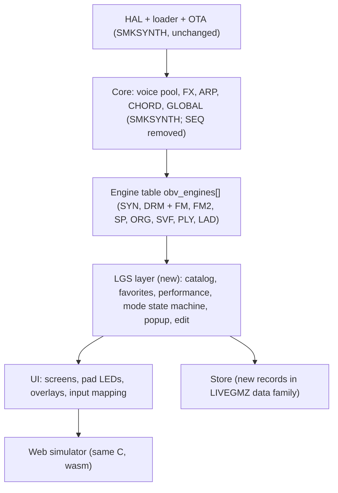

# 02 - Architecture

## 1. Layers



New code lives in `/src`; the layout mirrors SMKSYNTH so diffs stay reviewable:

```
src/
  firmware/
    app.ld crt0.S hal/ loader/            # imported from SMKSYNTH; only the flash-safety HAL files and loader/ stay verbatim (src/PROVENANCE.md)
    src/
      (SMKSYNTH files; names kept for now, we may rename freely since this is not a fork)
      lgs/
        lgs_catalog.h     # generated tables + accessors
        lgs_modes.h       # mode state machine, chord detection
        lgs_input.h       # logical knob/pad/button mapping (D-03)
        lgs_patch_ui.h    # PATCH screen + favorites
        lgs_perf_ui.h     # PERFORM + EDIT + popup
        lgs_perf.h        # performance model, ranges, solo, routing to parts
        lgs_fav.h         # favorites model
        lgs_store.h       # records, CRC, A/B slots
        lgs_fx_dist.h     # distortion send bus
      engines/            # ported engines + adapter shim (eng_*.c, lgs_engine_adapter.h)
  catalog/
    catalog.yaml          # source of truth for patches (see 04)
    samples/              # CC0 sources + conversion scripts
  tools/
    gen_catalog.py build.py fm1pkg_make.py ... (from SMKSYNTH) check_budget.py
  web/sim/                # extended simulator (see 07)
  tests/                  # host + wasm + golden
```

Rule: **do not rename or reformat SMKSYNTH files** you merely include. Add `lgs_*` files and thin hooks.

## 2. Parts and routing

| Part  | Role    | Sounds when                                                                        |
| ----- | ------- | ---------------------------------------------------------------------------------- |
| 0 (A) | LAYER 1 | PATCH mode (always, full range); PERFORM when not in solo and key within its range |
| 1 (B) | LAYER 2 | PERFORM when not in solo and key within its range                                  |
| 2 (C) | SOLO 1  | PERFORM only when SOLO 1 active (full keyboard)                                    |
| 3 (D) | SOLO 2  | PERFORM only when SOLO 2 active                                                    |

- A key-down is routed at note-on to the parts whose range contains the note; the routing decision is stored with the
  voice so note-off always reaches the same part even if the mode/octave changes meanwhile (SMKSYNTH already has
  `obv_pending`/focus-change handling; reuse the "release preserves old destination" behavior from SL2).
- Entering/leaving solo: release held notes of the outgoing set with their normal release (no hard cut, no stuck notes),
  then activate the new set.
- Sustain pedal/button per line: honored only if the line's `sustain` flag is YES.
- Pitch bend per line: scales to 0 if `bend` is NO.
- Mod wheel per line: action selected by `mod` (see 03 section 7).

## 3. Engine adapter

SMKSYNTH engines implement `obv_engine_ops_t` (`start/render/hit/track_render/reset/busy`). Clipper engines implement
`engine_t` (`note_on/render/block/amp/done`). T2.0 builds `lgs_engine_adapter.h`:

- Maps one SMKSYNTH part to one Clipper `track_t`/arena and exposes it through `obv_engine_ops_t`.
- Keeps SMKSYNTH's ISR-owned `READY/OUT/IN` switching: new patch = `obv_engine_accept(part, engine)`; old engine
  fades, new one boots fresh. No substitution of missing engines.
- The 4 patch parameters (K1-K4) are exposed by each engine as a **macro map**: `{label, getter/setter, min, max}`
  x4 (see 05).
- Heavy arenas (FM6, SAMPLE zones, PHYS) are per part; worst case 4 heavy arenas must fit RAM. **VERIFY in T0.3**,
  otherwise constrain: "at most N heavy-engine parts concurrently" and refuse such a performance in EDIT with a message.

## 4. Voice budget

SMKSYNTH shares a pool of 8 voices for ANALOG. A layered note in the overlap region costs 2 voices, a layered

- unison patch more. Targets:

* Minimum acceptable: 8 total voices with graceful stealing (oldest released first, 1-block declick fade).
* Stretch: raise `NV` to 12 if CPU measurement (T0.3) allows.
* Sampler/ORG/FM voices count against the same pool unless an engine has its own pool (Clipper FM6 = 6 voices).

## 5. Realtime and safety rules (summary; full list in 06)

1. Audio ISR: no flash access, no UI, no allocation, bounded time. All code and data it touches while flash is busy
   must be in RAM text/data sections (SMKSYNTH `.ram_text`).
2. Patch/performance changes are **requests** posted to the existing event ring; the ISR applies them at a block
   boundary (never mutate part state from the main loop while the ISR renders it).
3. Flash writes only from the main loop, only to allow-listed sectors, with audio engine marked busy/muted for the
   erase window (SMKSYNTH `busy` hook).
4. Render CPU is measured every build (`render_ticks`, `peak_ticks`, overloads); a worst-case combo (4 heavy parts,
   full polyphony, all FX on) must stay under 70% of the block deadline.
5. UI never blocks audio: LCD drawing is time-sliced as SMKSYNTH does (40 ms slots).

## 6. Memory budgets (targets; confirm in T0.3)

| Region                        | Budget                                                                                     | Notes                                                                              |
| ----------------------------- | ------------------------------------------------------------------------------------------ | ---------------------------------------------------------------------------------- |
| XIP (code + const)            | **<= 320 KiB today** (app slot 0x50000; can grow only by moving user data, see T0.1 notes) | SMKSYNTH image 220 KiB; ~100 KB free                                               |
| - code (core + new engines)   | <= 300 KiB                                                                                 |                                                                                    |
| - catalog + patch data        | <= 40 KiB                                                                                  | ~448 slots x ~40 B + names                                                         |
| - sample ROM (SP)             | <= 160 KiB initially                                                                       | IMA ADPCM, a handful of CC0 zones (piano, strings, flute, brass, vibes, bass, kit) |
| RAM (data/bss)                | <= 96 KiB                                                                                  |                                                                                    |
| POOL                          | <= 336 KiB                                                                                 | FX lines, arenas, UI canvases                                                      |
| User flash (LIVEGMZ settings) | 10 sectors from SMKSYNTH settings region                                                   | favorites 64 x ~16 B, performances 112 x ~64 B, globals                            |

## 7. Build pipeline additions

1. `catalog/catalog.yaml` -> `tools/gen_catalog.py` -> `src/firmware/src/lgs/gen/lgs_catalog_data.h` (checked
   into git so builds do not require Python at link time; CI verifies it is up to date).
2. `tools/check_budget.py`: fails the build when XIP/RAM/POOL budgets are exceeded or CPU baseline regresses > 25%.
3. Package: unchanged `fm1pkg_make.py` flow; identity/family strings updated (D-01, D-38).
