# 03 - UX Specification

Panel: 37 keys, 8 endless knobs (K1-K8, left to right), 4 faders, 16 pads (2 rows x 8, RGB), arrows `<` `>`,
buttons incl. KNOB BANK, FADER BANK, PATCH (HOME), PARA (EDIT), CHORD, NOTE REPEAT, SCALE, GLOBE, BT, ARP, FX,
OCTAVE-/+. The SEQ, SEQ PLAY and SEQ REC buttons exist on the panel but are unused (sequencer removed, D-50). Pitch and mod wheels. Display 240x240 (assumed 30 cols x 15 rows, **VERIFY**).

UX principles: the layout of the controls **never changes between modes** except where stated; every action gives
immediate visual feedback; destructive actions need confirmation; the user is never more than one button from PATCH
or PERFORM.

## 1. Control map (D-03)

| Control                                                              | PATCH mode                                                                                          | PERFORM mode         | EDIT mode                               | Popup (search)            |
| -------------------------------------------------------------------- | --------------------------------------------------------------------------------------------------- | -------------------- | --------------------------------------- | ------------------------- |
| K1                                                                   | param 1 (CUTOFF/brightness)                                                                         | param 1              | **line select**                         | **list navigation**       |
| K2                                                                   | param 2 (RESO/...)                                                                                  | param 2              | **patch select** (p1)                   | -                         |
| K3                                                                   | param 3 (ENV AMT/...)                                                                               | param 3              | **low octave** (p1)                     | -                         |
| K4                                                                   | param 4 (RELEASE/...)                                                                               | param 4              | **high octave** (p1)                    | -                         |
| K5                                                                   | tempo (SELECT, as SMKSYNTH)                                                                         | same                 | **volume 0-99** (p1) / **sustain** (p2) | -                         |
| K6                                                                   | category                                                                                            | bank A-H             | **pitch bend YES/NO** (p2)              | -                         |
| K7                                                                   | patch within category                                                                               | combo slot 1-14      | **mod wheel action** (p2)               | -                         |
| K8                                                                   | **MASTER**                                                                                          | **MASTER**           | **MASTER**                              | **MASTER**                |
| Faders 1-4                                                           | FX sends CHORUS, DELAY, DIST, REVERB                                                                | same, active line    | same, edited line                       | same                      |
| `<` `>`                                                              | previous/next category                                                                              | (unused)             | open popup / change category            | change category           |
| Pads 1-16                                                            | favorites                                                                                           | combos + solo        | pre-select category N for the line      | pad1 confirm, pad2 cancel |
| KNOB BANK                                                            | go PATCH; repeat = bank A->D                                                                        | go PATCH             | (see 4)                                 | -                         |
| FADER BANK                                                           | go PERFORM; repeat = bank A->H                                                                      | repeat = bank A->H   | (see 4)                                 | -                         |
| KNOB BANK + FADER BANK                                               | -                                                                                                   | **enter EDIT**       | open popup                              | -                         |
| BT                                                                   | **Save/Copy dialog** (section 11)                                                                   | **Save/Copy dialog** | **Save/Copy dialog** (exits EDIT)       | -                         |
| PARA (EDIT)                                                          | as SMKSYNTH                                                                                         | as SMKSYNTH          | toggle EDIT page 1/2                    | -                         |
| KNOB BANK long (700 ms)                                              | panel check                                                                                         | panel check          | panel check                             | -                         |
| ARP / CHORD / GLOBE / FX / PARA / ENV / NOTE REPEAT / SCALE / OCTAVE | **as SMKSYNTH**                                                                                     | as SMKSYNTH          | as SMKSYNTH                             | -                         |
| PATCH (HOME)                                                         | short press: return to main screen; if a Drums patch is loaded, toggles pads DRUMS/FAVORITES (D-12) | same                 | prompt save/discard then exit EDIT      | cancel                    |

SEQ / SEQ PLAY / SEQ REC buttons: unused (D-50; may be given a job later if there is room to bring the sequencer back).
`IDEA.md` promised a finer spec of K5-K7 "below" but did not give one: the table above was proposed and approved (D-11).
Sustain comes from the SMK-37's physical sustain input (D-44).

K8 note: `IDEA.md` says K8 "does nothing for now" in EDIT mode; but "last knob is always MASTER" wins (D-03).
EDIT has 8 per-line items and only K1-K7 free, hence two pages toggled by PARA (page 2 is shown with `2/2` in the header,
OQ-16 pending confirmation).

Master rule (inherited from SMKSYNTH K8): endless encoder as virtual pot, 24 steps of 1024 per detent, default ~70% (SMKSYNTH also
restores the last saved level at boot), shown as a bar overlay. Logical names in `src/firmware/src/lgs_input.h` (T0.4).

FX sends/faders: soft takeover (a fader acts only after crossing the stored value when the active line changes or on
mode change) with a 1.5 s overlay bar `DLY ####------ 40` (reuse `smk_overlay`/`smk_bar`).

## 2. Mode state machine

```mermaid
stateDiagram-v2
  [*] --> PATCH
  PATCH --> PERFORM: FADER BANK
  PERFORM --> PATCH: KNOB BANK
  PERFORM --> EDIT: KNOB BANK + FADER BANK
  PERFORM --> SAVE_COPY: BT
  PATCH --> SAVE_COPY: BT
  EDIT --> SAVE_COPY: BT
  SAVE_COPY --> PERFORM: pad1 confirm / pad2 cancel
  EDIT --> POPUP: arrows / chord
  POPUP --> EDIT: pad1 confirm / pad2 cancel
  EDIT --> SAVE_PROMPT: PATCH / KNOB BANK / FADER BANK
  SAVE_PROMPT --> PERFORM: pad1 save / pad2 discard
  PATCH --> SAVE_FAV: hold pad (700 ms)
  SAVE_FAV --> PATCH: same pad within 5 s = saved (2 s msg); timeout/other = cancel
```



- ARP/GLOBAL/FX screens overlay the main mode as in SMKSYNTH; leaving them returns to the previous main mode.
- Chord detection: KNOB BANK and FADER BANK pressed within 120 ms of each other = chord; single-press actions are
  triggered **on release** and are suppressed if a chord occurred during the press (D-37).
- EDIT is reachable only from PERFORM. In EDIT, single-press KNOB BANK/FADER BANK/PATCH open the save/discard
  prompt (D-36).

## 3. PATCH mode

```
[PATCH] Bank A - 16          row 0: mode, bank A-D, last pressed favorite pad (1-16) if any
Pianos - 001 - Acoustic      row 1: category - patch number - name
> 001 - Acoustic             rows 3-7: list window, > = cursor
  002 - Acoustic 2
  003 - Chorus Grand
  004 - FM EP 1
  005 - FM EP 2
6-Op FM Engine               last row: engine name
```

- Favorites category ("01 Favorites") lists the 64 favorites as `F001..F064`; empty slots show `F017 -`
  and cannot be loaded.
- K6/arrows change category; K7 moves within the category; loading is immediate on selection (no confirm).
  Loading resets tweaks (D-07).
- Pad tap = load favorite (patch + tweaks + sends). Bank A-D cycles via KNOB BANK; bank letter shown in row 0.
- Pad hold (700 ms): prompt `Overwrite F0xx?  Press pad again (5s)`; same pad within 5 s saves current patch + tweaks +
  FX sends, shows `Saved successfully` for 2 s, returns to the PATCH screen. Timeout, any other pad, any other button:
  prompt closes, nothing saved. Empty slots use the same flow with text `Save to F0xx?`.
- Pad LEDs: see section 8.

## 4. PERFORM mode

```
[Performance][BANK A-1]
[LAYER 1] 001 - BASS (C1-C3)
[LAYER 2] 157 - BRASS (C4-C7)
[SOLO 1] - 300 - LEAD
[SOLO 2] - 128 - MARIMBA
```

- Slot number 1-14 (pads 1-7 -> slots 1-7, pads 9-15 -> slots 8-14). `IDEA.md` shows `A-16` in one mock: a typo (D-15).
- Pad tap on a combo loads all four lines at once (atomically at a block boundary).
- Pad 8 = SOLO 1, pad 16 = SOLO 2: tap enters solo, tap same again leaves (D-23). While solo is active the active
  line indicator (`*`) moves to the solo row and the layer rows are shown dim.
- While a solo is active, pressing any non-solo combo pad **only exits the solo** (same as pressing the solo pad again);
  a further press changes the performance (D-16).
- Tapping the other solo pad while in solo switches directly to it.
- Empty lines show `-`. Empty combo pad slot = unlit pad, tap does nothing.
- Faders act on the _active line_: last line that received a note-on; default LAYER 1; in solo the solo line.

## 5. EDIT mode

```
[EDIT][Performance][A-7] 1/2
> [LAYER 1] F001 - Piano (C1-C7)
  [LAYER 2] -
  [SOLO 1] -
  [SOLO 2] -
Range: C1-C7. Volume: 99          (page 1)
Sustain: YES  Bend: YES  Mod: DEFAULT   (page 2, header shows 2/2)
```

- `>` marks the line being edited (K1 moves it, on both pages). The detail rows below describe the selected line.
- `F` prefix when the line's patch was chosen from the FAVORITES category, otherwise the immutable patch number (D-31).
- PARA toggles page 1/2 (D-49). **Page 1:** K1 line, K2 patch (scrolls **all** patches, global order), K3 low octave
  (C1..C7), K4 high octave (>= low, C1..C7), K5 **line volume** 0-99 (the volume of that item inside the combination; it
  does not touch the global level). **Page 2:** K1 line, K5 sustain YES/NO (default YES), K6
  pitch bend YES/NO (default YES), K7 mod action. K8 is always the global MASTER on every page and mode.
- Pads 1-15: pre-select the first patch of category N for the selected line (pad 1 = F001/favorites, pad 2 = Acoustic
  Piano, ... pad 15 = Drums, pad 16 = ICONIC). Does nothing while the popup is open except pads 1/2.
- Faders: set FX sends of the selected line (soft takeover).
- Exit: PATCH/KNOB BANK/FADER BANK -> `Save changes?` prompt, pad 1 (blue) save, pad 2 (red) discard. Edits apply live
  (audible) to the working copy; storage happens only on save. Timeout 10 s on the prompt = stay in EDIT.

## 6. Ranges (D-14, D-39)

- Each line stores `lo_oct` and `hi_oct` (1..7, `lo_oct <= hi_oct`). The line sounds from **C of `lo_oct` through B of
  `hi_oct`**; display `(C{lo}-C{hi})`, e.g. `(C1-C3)` and `(C4-C7)` are contiguous.
- Defaults for a new line: `C1-C7`.
- Ranges may overlap (pure layer) or be disjoint (split); no automatic derivation.
- Range is evaluated on the _played note after OCTAVE shift_ (default; changing OCTAVE+/- moves what each line plays).
  Revisit after simulator review if live use shows this is confusing.
- Solo lines have **no range** (D-54): a solo plays on the whole keyboard, EDIT shows `Solo: whole keyboard` and K3/K4 do nothing for them.
- Rejected: automatic derivation of the high note from the other layer (owner wants the upper octave knob).

## 7. Mod wheel actions (per line)

`DEFAULT` (engine vibrato, SMKSYNTH behavior), `OFF`, `FILTER` (cutoff up), `BRIGHT` (engine brightness macro: FM
modulator level/organ percussion/etc.), `SWELL` (volume), `REVERB` (send). Engines that cannot implement an action fall
back to `OFF` and the option is skipped in K7 for that engine.

## 8. Pad LED conventions

| State                                   | Colour                                                                   |
| --------------------------------------- | ------------------------------------------------------------------------ |
| PATCH: favorite slot empty              | **dark** (no light)                                                      |
| PATCH: favorite slot filled             | the patch's category colour, dim                                         |
| PATCH: currently loaded favorite        | **white, blinking** (about 2 Hz)                                         |
| PERFORM: combo slot empty               | **dark**                                                                 |
| PERFORM: combo slot filled              | blue, dim                                                                |
| PERFORM: combo slot selected            | **green, blinking**; steady and dim while a solo is active               |
| PERFORM: cursor on an empty slot        | that pad **blinks red**; the loaded one stays steady green; row 1 says `(empty slot) now: A-3` |
| PERFORM: SOLO 1 / SOLO 2 (pads 8, 16)   | no patch on the line: dark; otherwise **both orange**, steady; the active solo **blinks** |
| EDIT: category pads                     | one distinct colour per category (16-colour palette), selected category bright |
| Popup: pad 1 / pad 2                    | solid blue / solid red; all others dark                                  |
| Save prompts: target pad                | blinking white during the 5 s window                                     |
| Drums category loaded                   | violet (SMKSYNTH drum-pad violet), white flash on hit (D-04)             |

Blinking is `(fm1_ms >> 8) & 1` (full / 10 %), computed in `leds_update()` on every UI pass, so it needs no timer.

## 8a. Navigation lands on a sound (D-56)

- `<` `>` and K6 change the category in PATCH and **load its first sound** (Favorites: the first filled favorite of the current bank). K7 moves within the category. In Favorites the bank letter follows the cursor.
- KNOB BANK in PATCH moves to the next bank A-D, and the list jumps to that bank's first filled favorite and loads it. FADER BANK in PERFORM does the same with performances (bank A-H, first filled slot).

- **The EDIT search popup auditions**: moving the cursor (K1, arrows) plays the highlighted sound on the edited line, and keys sound on that line whatever its octave range. Pad 1 confirms, pad 2 or leaving the popup puts the stored sound back. The popup opens on the line's own patch.

## 8b. Hints and live feedback (D-55)

- **Hint line** only in EDIT (row 1, per page and line type). PATCH and PERFORM keep row 8 empty; the drum kit shows `Pads play the drum kit`. Messages and the value bar take the row while they last. Rows hold 30 characters (8 px font on 240 px).
- PERFORM shows **how loud each line sounds** as one character after the `>` marker (`.` `:` `+` `#`, from the mixer's per-part peak, sampled every 80 ms).
- The favorite **overwrite prompt** names what is there now and what will replace it (`now:` / `with:`).
- Tapping a combination pad during a solo only leaves the solo and says `Solo off - tap again to load`.
- Patch names are shown without their engine prefix; ICONIC names have none and are shown whole.

## 9. Visual feedback for K1-K4 and faders

Overlay for 1.5 s under the page: label + value + 16-cell bar, e.g. `CUTOFF  ########--------  2.4k`. Labels come
from the engine macro map (05). Value of a knob turn always shows immediately; the overlay hides after 1.5 s of
inactivity (reuse `smk_overlay` / `smk_bar`).

## 10. Display strings

Engine names: SYN `Synth Engine`, FM `6-Op FM Engine`, FM2 `4-Op FM Engine`, SP `Sampler Engine`, ORG `Organ Engine`,
SVF `Twin SVF Engine`, PLY `Poly Engine`, LAD `Ladder Engine`, DRM `Drum Engine`. Patch name max 16 characters, prefix
included.
Mode tags: `[PATCH]`, `[Performance]`, `[EDIT][Performance]`.

## 11. Save/Copy dialog (BT, D-40)

Purpose: copy or save a favorite/performance **to a chosen destination** (other bank and slot), not only in place.

```
[SAVE] Performance           header: what is being saved/copied
From: A-7                    source (current)
To:   C-3  (empty)           destination: K6 = bank, K7 = slot; shows what would be overwritten
Pad1 = OK   Pad2 = CANCEL
```

- PATCH: source = current patch + tweaks + FX sends; destination = favorite bank A-D (K6), slot 1-16 (K7). Equivalent
  to the pad-hold save but with a free destination.
- PERFORM: source = current performance; destination = bank A-H (K6), slot 1-14 (K7). Pure copy, the source is kept.
- EDIT: source = the working copy; destination defaults to the slot being edited; BT then leaves EDIT after saving.
- Destination non-empty: the row shows `OVERWRITE: <summary>`; pad 1 (blue) confirms, pad 2 (red) cancels. Other pads and
  the music keep working (the dialog never blocks audio). Timeout 10 s = cancel. Success message `Saved successfully` for 2 s.
- BT has no other job (sequencer removed, D-50).
