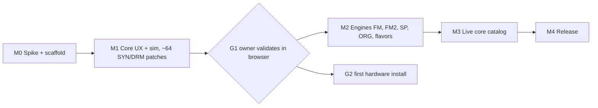

# 09 - Roadmap

Statuses: `todo`, `doing`, `done`, `blocked`. Update on completion. One card = one agent session.

| Milestone | Goal                                                                                                             | Exit                                                                                            |
| --------- | ---------------------------------------------------------------------------------------------------------------- | ----------------------------------------------------------------------------------------------- |
| M0        | Toolchain, own code base in `/src` (imported, not forked), budgets measured, input mapping and safety audit done | `/src` builds and reproduces the reference package byte for byte; budget numbers recorded in 02 |
| M1        | Full UX (PATCH, PERFORM, EDIT, popup, favorites, solo, FX sends, DIST) on SYN+DRM, simulator                     | G1: owner approves UX in the browser                                                            |
| M2        | Engines ported behind the adapter, with starter patches                                                          | Each engine admitted per 05 section 1; CPU budget passes                                        |
| M3        | Live core catalog (~105 patches + 5 kits) with golden renders                                                    | All catalog items `tuned` or consciously deferred                                               |
| M4        | Install guide, manifest, release package, G2/G3 hardware gates                                                   | Release candidate                                                                               |

## Task index

| Card file                                  | Cards                      |
| ------------------------------------------ | -------------------------- |
| [tasks/M0-spike.md](tasks/M0-spike.md)     | T0.1 - T0.7                |
| [tasks/M1-core.md](tasks/M1-core.md)       | T1.1 - T1.13 (incl. T1.5b) |
| [tasks/M2-engines.md](tasks/M2-engines.md) | T2.0 - T2.8                |
| [tasks/M3-catalog.md](tasks/M3-catalog.md) | T3.1 - T3.4                |
| [tasks/M4-release.md](tasks/M4-release.md) | T4.1 - T4.3                |

## Status board

| Card            | Status | Notes                                                                                                                         |
| --------------- | ------ | ----------------------------------------------------------------------------------------------------------------------------- |
| T0.1            | done   | see notes/T0.1-build-notes.md (app slot is 320 KiB, RAM nearly full)                                                          |
| T0.2            | done   | `/src` created (no fork); import fidelity verified, see src/PROVENANCE.md                                                     |
| T0.3 .. T0.7    | todo   | T0.4, T0.5, T0.6 done (safety audit + build gates: DOCs/safety-audit.md); T0.7a done; next: T0.3 re-measure, T0.7b-d, then M1 |
| T1.1, T1.2, T1.3, T1.4, T1.5, T1.5b, T1.6, T1.7, T1.8, T1.10 | done (simulator) | UI in `src/firmware/src/lgs_ui.h`, model in `lgs_model.h`, catalog from `src/catalog/catalog.json` (64 SYN patches; drums empty until M2). `tests/ui_scenarios.mjs` 60/60. Per-line sustain/bend/mod are applied (pedal, wheels, mod actions; `ui_scenarios.mjs` 69/69). Gap: KNOB BANK long-press panel check; DIST bus already exists in the engine (no new DSP). |
| T1.9            | done (not run on hardware) | A/B image with CRC and generation (`lgs_ab.h`, `lgs_store.h`), simulator persistence in localStorage, device flash via guarded `sector_save`; `store_ab_test.c` power-cut suite, `store_test.mjs`; see safety-audit.md section 6 |
| T1.11, T1.12, T1.13 | done | simulator page (wheels, pedal, persistence), `tests/run_tests.sh` (scenarios, 10 screen goldens, storage, flash safety, package), owner guide `src/web/sim/README.md`. **G1: waiting for the owner's UX sign-off in the simulator** |
| T2.0, T2.1b, T2.2, T2.4 | done (simulator, numbers only) | adapter `lgs_engine_adapter.h` (32-sample windows, 16-sample delay), FM2 (30 presets, `lgs_eng_fm2.h`) and ORG (14, `lgs_eng_org.h`) generated from Clipper by `tools/port_clipper_engines.py`; Drums = the existing DRUMS engine with 5 kits. `tests/engines_test.mjs`: every patch sounds, no clipping, tails end, ORG pitch. Not listened to yet. |
| T0.7b-d | done | MIDI input (`lgs_midi.h`: notes, CC 1/7/64/120/123, bend, clock), panel check (KNOB BANK held 0.7 s: faders, wheels, pedal, buttons, voices, render time and overruns on the device), parameter pages on ARP / LFO / SEL / ENV / GLO / FX buttons (FX = the global effect units and the DRIVE send), `obervave.c` and its UI/sequencer headers removed from the tree (copies in `~/lgs-scratch/removed-t07d`, originals in `SMKSYNTH/`) |
| T2.3, T2.5 | done (simulator) | SP engine (`lgs_eng_sp.h`, 8 sample sets, 16 presets; data from `tools/gen_lgs_samples.py`), 12 SVF / PLY / LAD patches (`lgs_flavors.h`). Catalog grew to 161 patches |
| T2.1 (FM6) | done (simulator) | msfa core + Clipper's 8 authored voices (`lgs_eng_fm6.h`, `lgs_fm6_core.h`); 184 patches after the repertoire round (DOCs/notes/repertoire-coverage.md), image 268 KB of 320 KB |
| T2.6, T2.7, T2.8, T0.3 | todo | CPU budget (six-operator FM is the heaviest engine) and the heavy-engine guard need device counters (the panel check shows them) |
| T3.1 - T3.4 | done (simulator) | catalog of 436 patches (ICONIC, D-53, has 252). Level-matched by measurement: per-patch trim in `catalog/trims.json`, `tests/catalog_health.mjs` (peak <= -6 dBFS, loud part within 6 dB of the median, golden render hashes in `catalog/golden.json`). **Not judged by ear**: that stays with the owner |
| T4.1 | done | `tools/name_review.py` (0 findings, D-42), `THIRD_PARTY.md`, PROVENANCE rows |
| T4.2 | done (not run on hardware) | `tools/package_release.py` (manifest, SHA256SUMS, notes, site), `DOCs/install-guide.md`, installer page `src/web/install/` (identity record, restore kit, install, resume, restore; `tests/installer_test.mjs` runs it against a fake keyboard), Pages workflow |
| T4.3, T2.8 | todo | G2 first install (after the restore kit is saved), G3 soak; first-install package for stock V016 is not built |
| everything else | todo   |

## Parallelization guide

- After T0.2: T1.1, T1.2, T1.3 (UI-independent pieces) can run in parallel; T1.9 (store) and T1.11 (sim) are independent of UI.
- T2.1-T2.5 (engine ports) are independent of each other once T2.0 (adapter) is done.
- Catalog authoring (M3) is parallel per category.
