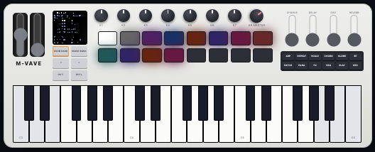

<h1 align="center">LiveGomezSynth</h1>

<p align="center"><b>A live-performance firmware for the M-VAVE SMK-37 Pro.</b><br>
436 sounds in 16 categories, four-part performances with layers, splits and solos, and a front panel that tells you what it is doing.</p>

<p align="center">


</p>

<p align="center"></p>

> **Read this first.** This is an unofficial, community firmware. **It has never run on a real keyboard.** Everything here was built and tested in a browser simulator that runs the firmware's own C code. Flashing a keyboard can fail. See [Risks](#risks) before you plug anything in.

---

## The idea

The SMK-37 Pro is a very good controller with a small synth inside. I wanted to play it **live**: pick a sound with one tap, split the keyboard between a bass and a lead, jump to a solo sound, and know what is going on by looking at the pads. No menu diving, no sequencer, no song mode.

So LiveGomezSynth is built around three ideas:

1. **Sounds first.** A big, organised catalog (436 sounds) covering what a gigging keyboard player reaches for: pianos, electric pianos, organs, strings, brass, pads, leads, basses, drums, and an **ICONIC** category of timbres that evoke well-known songs (rock, pop rock, 80s synth-pop, rock nacional, Latin rock, classical and fantasy).
2. **One tap performance.** Sixteen **favorite** pads for single sounds, and eight banks of **performances** (combos of four lines: two layers split by octave and two solo sounds).
3. **A UX that stays out of the way.** The controls never move between modes. The pads light up to tell you what is assigned and what is selected. Edits are live, and saving is always a deliberate two-step action.

It is a hobby project made by a keyboard player, with a lot of help from AI (see [Credits](#credits)).

## What you get

| | |
| --- | --- |
| **Sounds** | 436 patches, 16 categories: Favorites, Pianos, E-Pianos, Organs, Strings, Winds, Choirs, Brass, Guitars, Basses, Pads, Leads, SFX, Complex, Drums, **ICONIC** |
| **Engines** | Analog-style synth (OberVave voice core, plus twin-SVF, poly and ladder flavors), 4-operator FM, 6-operator FM (DX-style), drawbar organ, ADPCM sampler, and five drum kits |
| **Favorites** | 64 slots (4 banks of 16): one pad = one sound with its tweaks and FX sends |
| **Performances** | 8 banks of 14: each is **two layers** (split by octave range) and **two solos** (whole keyboard, one tap) with per-line volume, sustain, bend and mod-wheel action |
| **Controls** | 4 tweak knobs per sound, master volume, 4 faders with soft takeover (PATCH: the chorus, delay, distortion and reverb sends; PERFORM: one reverb send per line), pitch and mod wheels, sustain pedal, MIDI in |
| **Safety** | A/B storage image with CRC, guarded flash writes, an installer that refuses unsafe sources, a way back to stock |

## Try it now (no keyboard needed)

The simulator is the firmware's C code compiled to WebAssembly: the screen, the sound and the pad lights are the real ones.

```sh
cd src
sh web/sim/build.sh                              # needs zig and binaryen: brew install zig binaryen
python3 -m http.server -d build/sim-site 8737    # then open http://localhost:8737
```

**Online:** <https://agomezss.github.io/livegomezsynth/> (installer: <https://agomezss.github.io/livegomezsynth/install/>). Click the screen to start audio, then play with the mouse, your computer keyboard, or a MIDI keyboard.

## Cheat sheet

Three modes, one button each. The layout of the controls does not change between modes.

| Mode | Get there | Pads do | K1-K4 | K5 | K6 | K7 | K8 |
| --- | --- | --- | --- | --- | --- | --- | --- |
| **PATCH** | **KNOB BANK** | load a **favorite** | tweak the sound | tempo | category | patch in category | MASTER |
| **PERFORM** | **FADER BANK** | load a **performance**; pads 8 and 16 = **SOLO 1 / 2** | tweak | tempo | bank A-H | slot 1-14 | MASTER |
| **EDIT** | **KNOB BANK + FADER BANK** together, from PERFORM | pick a **category** for the selected line (pad 16 = ICONIC) | K1 line, K2 patch, K3/K4 octave range (layers only); **OCT-** / **OCT+** = that line's own octave | line volume | pitch bend (page 2) | mod action (page 2) | MASTER |

**Faders:** PATCH = chorus, delay, distortion and reverb sends of the sound; PERFORM and EDIT = the reverb send of each line (F1 to F4 = L1, L2, S1, S2: one effect, less CPU). **Everywhere:** `<` `>` = previous / next category. **BT** = Save / Copy. **PARA** = EDIT page 1/2. **SEQ** = screen theme: each press steps through eight (Classic, then Studio in Blue, Yellow, Green, Purple, Red, Pink and a high-contrast White), remembered across power cycles. The master volume shows a bar while you turn it. Hold **KNOB BANK** for 0.7 s = panel check.

### Pad lights

| Light | Meaning |
| --- | --- |
| dark | nothing assigned |
| colour (by category in PATCH, blue in PERFORM) | assigned |
| **blinking** white (PATCH) or green (PERFORM) | selected |
| orange, both solo pads | a solo is assigned; the **active solo blinks** |

### The ten things you will do

1. **Pick a sound:** PATCH, turn **K6** (category) and **K7** (patch). It loads as you scroll.
2. **Tweak it:** **K1-K4** change the four main parameters of that engine (cutoff, resonance, etc.; the screen shows the name and value).
3. **Save a favorite:** hold a pad for 0.7 s, then press **the same pad again** within 5 s. Anything else cancels.
4. **Play a favorite:** tap the pad.
5. **Play a performance:** FADER BANK, tap a pad. **K6** changes bank.
6. **Solo:** tap pad 8 or 16. The layers mute and the solo plays on the whole keyboard. Tap again to leave.
7. **Build a performance:** from PERFORM press KNOB BANK + FADER BANK. **K1** picks the line, **K2** the patch, **K3/K4** the octave range of a layer, **K5** its volume. **PARA** shows page 2 (sustain, bend, mod wheel action).
8. **Save it:** **BT**, then pad 1 to confirm or pad 2 to cancel.
9. **Shape the space:** in PATCH the four faders are the chorus, delay, distortion and reverb sends; in PERFORM they set how much each of the four lines feeds the reverb.
10. **Shift the keyboard:** **OCT-** / **OCT+** (press both to reset). In EDIT they change only the octave of the selected line.

Full details: [DOCs/03-ux-spec.md](DOCs/03-ux-spec.md).

## Installing on a keyboard

**Not yet validated on hardware.** The release folder contains an installer page (Web MIDI, desktop Chrome or Edge, HTTPS) that:

- reads what the keyboard runs now and **refuses anything it does not know**;
- asks you to save an identity record and a **restore kit** (the package of your current firmware) before it writes;
- verifies the package SHA-256 and structure, writes it, and resumes an interrupted transfer;
- is the same update mechanism the SMKSYNTH project uses.

Read the [install guide](DOCs/install-guide.md) first. It is short and it matters. In particular: this release is an **update** package, so the keyboard must already run **SMKSYNTH** (or LiveGomezSynth). A keyboard on the stock M-VAVE firmware needs a first-install package that is **not built yet**.

## Risks

Be honest with yourself about these before flashing.

| Risk | What to know |
| --- | --- |
| **Untested on hardware** | The first install is gate G2 in [the roadmap](DOCs/09-roadmap.md). Until it is done, treat every claim here as "works in the simulator". |
| **Bricking** | A bad flash can leave the keyboard unusable. The firmware never writes the calibration/BT/key area (`0xC1000`), flash writes go through one guarded function, storage is a two-slot image with CRC, and the update loader is SMKSYNTH's, unchanged. None of this removes the risk. |
| **No flash dump** | The update protocol only lets the keyboard *pull* a package; there is no way to read its flash from the browser. Your safety net is the package of your current firmware, plus M-VAVE's own M-UPGRADE tool with the factory package. |
| **User data is re-initialised** | The first start of a new firmware family re-initialises the user-data bank. Back up your SMKSYNTH banks first. |
| **Warranty and support** | This is not endorsed by M-VAVE. A modified firmware may void your warranty. The software is provided **as is**, with no warranty (GPL-3.0, section 15). |
| **First-draft sounds** | The 436 sounds were authored from parameters and level-matched by measurement. They were never judged by ear on the real hardware; expect to tweak. |
| **Names and trademarks** | Sound names hint at songs or sounds but avoid brands and people (a name check runs in the tests). M-VAVE, SMK-37 and other names belong to their owners. |

## Repository tour

```
README.md            this file
AGENTS.md            the technical handoff for AI agents and new contributors
DOCs/                specs, decisions (D-xx), roadmap, safety audit, install guide, IDEA.md (the original idea)
src/                 everything we build
  firmware/          the C firmware (hal/ and loader/ are protected, verbatim)
  catalog/           catalog.json (the sounds), trims.json (levels), golden.json (renders)
  tools/             generators, build, release and review scripts
  tests/             scenarios, engines, levels, storage, flash safety, installer
  web/sim/           the browser simulator     web/install/  the installer page
```

The three reference projects used to build this (`SMKSYNTH/`, `smk37_open/`, `clipper-smk/`) are **not** part of this repository; see [AGENTS.md](AGENTS.md) for how to get them back if you need to regenerate engine data.

## Developing

```sh
cd src
sh tests/run_tests.sh --quick     # simulator build, UI scenarios, engines, levels, fuzz, screens, storage, flash safety, names, installer
sh tests/run_tests.sh             # the same plus the device package build (needs the JieLi toolchain, see src/README.md)
python3 tools/package_release.py --build   # checks, then writes release/<version>/ with the package, manifest and site
```

AI agents and new contributors: start with [AGENTS.md](AGENTS.md). It is written so you do not have to read the whole tree.

## Publishing

`release/latest/site` is a static site (simulator at `/`, installer at `/install/`). A GitHub Actions workflow publishes it to GitHub Pages when you push a new `release/latest`. HTTPS is required for Web MIDI.

## Credits

**This project stands on other people's work. Their licenses and notices stay with their code.** Full text in [src/THIRD_PARTY.md](src/THIRD_PARTY.md) and [src/PROVENANCE.md](src/PROVENANCE.md).

| Project | Author | What we took | License |
| --- | --- | --- | --- |
| [**SMKSYNTH**](https://github.com/4t59m4f784-creator/SMKSYNTH) | Marcus Padrini | The base of this firmware: the performance-first approach, UI conventions, the packaging flow, the update loader, the hardware layer and the build tools (the package we build matches SMKSYNTH 1.2.0 byte for byte with the same parameters) | GPL-3.0 |
| [**OberVave**](https://github.com/zvenson/obervave) | zvenson | The analog-style voice core and effects | GPL-3.0 |
| [**JIANT** (DRUM-X)](https://github.com/juanjiant-bit/JIANT) | Juan Ignacio Antonucci | The drum engine and the five kits | GPL-3.0 |
| [**Felucca**](https://github.com/hugelton/Felucca) | Leo Kuroshita, Hügelton Instruments | The firmware platform everything descends from | GPL-3.0 |
| [**SLOOP**](https://github.com/isod89/sloop-fm1) | isod89 and contributors | Platform and tooling lineage | GPL-3.0 |
| **SMK-37 port layer** ([fm1-to-smk37](https://github.com/genkigenki/fm1-to-smk37)) | M. Geisler (genkigenki) | Getting this firmware family onto the SMK-37 | GPL-3.0 |
| [**Clipper**](https://github.com/isod89/clipper-fm1) and its SMK-37 Pro port (we used the one hosted at [davidozz0/clipper-smk](https://github.com/davidozz0/clipper-smk)) | isod89 and contributors | The 4-operator FM, drawbar organ and sampler engines, the 6-operator FM glue and voices, sample data pipeline | GPL-3.0 |
| [**music-synthesizer-for-android**](https://github.com/google/music-synthesizer-for-android) / [**Dexed**](https://github.com/asb2m10/dexed) | Google Inc.; Pascal Gauthier | The 6-operator FM core (msfa), integer port | Apache-2.0 |
| [**SMK37 OPEN**](https://github.com/m-vave/smk37_open) | M-VAVE | Official hardware SDK and documentation (reference only) | GPL-3.0 with linking exception |
| JieLi AC79 SDK | JieLi | Boot files read from your own SDK checkout at build time, never stored here | Apache-2.0 |
| CC0 samples | see `ATTRIBUTION.txt` in the Clipper port | Piano, horns, strings and flute sample sets | CC0-1.0 |

**AI assistance.** This firmware, its tools and its documentation were written with AI coding assistants under the direction of the project owner, who defined the goals, the user experience and the repertoire, and who will do the hardware testing. Treat the code as you would any new code: review it.

## License

GPL-3.0-only. See [LICENSE](LICENSE). Keep the SPDX and copyright headers in every file that has one.
